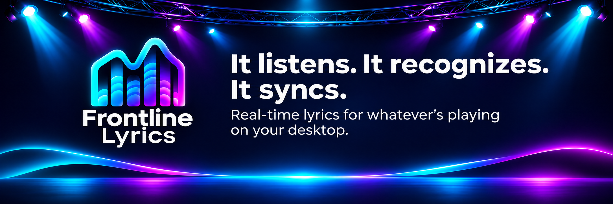
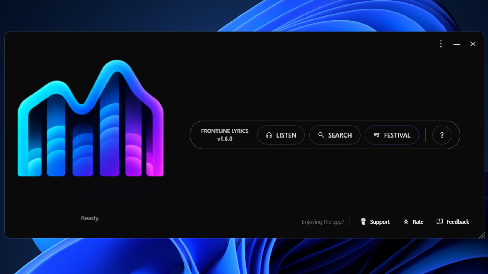
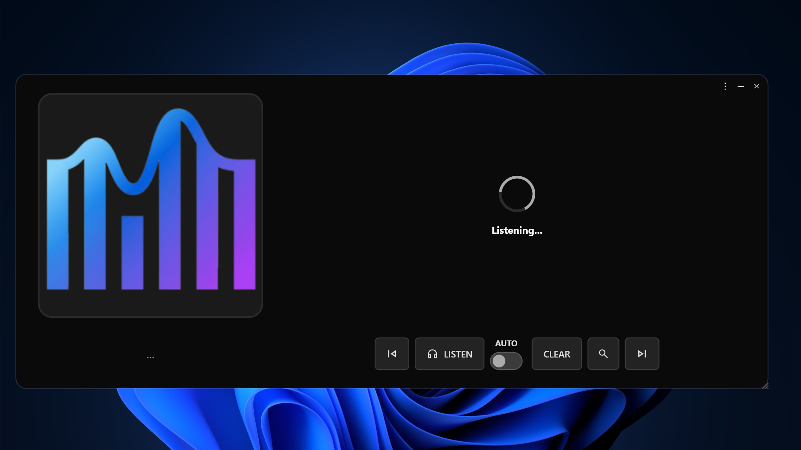
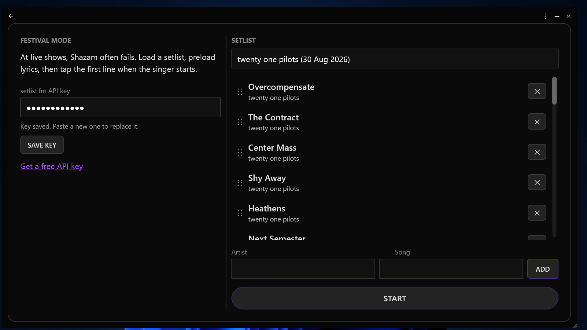
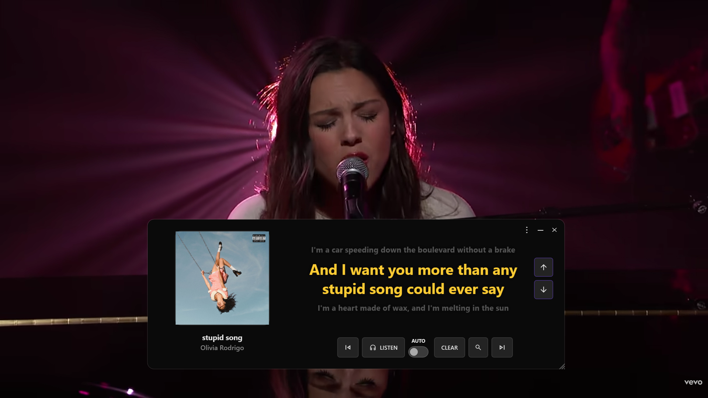

<div align="center">



**Real-time, synchronized lyrics for the music playing on your computer.**

[](https://apps.microsoft.com/detail/9P6LNJCL8ZCC)


[](CONTRIBUTORS.md)

<a href="https://get.microsoft.com/installer/download/9P6LNJCL8ZCC?referrer=appbadge&cid=readme" target="_self">
  
</a>


https://github.com/user-attachments/assets/0a6f3278-49b2-43f0-9004-6709d65f74b9

</div>

---

## Contents

- [About](#about)
- [Features](#features)
- [How It Works](#how-it-works)
- [Installation](#installation)
- [Usage](#usage)
- [Screenshots](#screenshots)
- [Project Structure](#project-structure)
- [Building From Source](#building-from-source)
- [Running Tests](#running-tests)
- [Contributing](#contributing)
- [Support](#support)
- [License](#license)

## About

FrontLine Lyrics displays synchronized song lyrics in an always-on-top desktop overlay. It can follow playback metadata from compatible media players or recognize music from system audio, then look up synchronized lyrics and show them as the song plays.

The project supports a Windows desktop frontend and a Linux frontend sharing a Python-based backend. Availability and integration details depend on the platform.

## Features

- Real-time synchronized lyrics in a customizable desktop overlay.
- Song recognition using audio fingerprinting.
- Automatic tracking from supported media sessions (Windows media sessions / Linux MPRIS).
- Manual lyrics search and synchronization adjustments.
- Live translation and romanization options.
- Font, color, and theme customization, including seasonal themes.
- Multiple interface languages.
- Festival Mode with editable setlists and manual line synchronization (feature availability may vary by platform).
- Optional anonymous telemetry; see [PRIVACY.md](PRIVACY.md).

## How It Works

FrontLine Lyrics has two parts: a **Python backend** that handles recognition, lyrics, translation, and media integration, and a **desktop frontend** that displays the lyrics and communicates with the backend over a local WebSocket connection.

- **Windows:** WPF / .NET frontend, with Windows media-session and WASAPI audio integration.
- **Linux:** Avalonia / .NET frontend, with Linux-specific media and audio integration.

## Installation

### Windows

Install the official Windows version from the [Microsoft Store](https://apps.microsoft.com/detail/9P6LNJCL8ZCC).


### Linux

The Linux version is being prepared for distribution. Until it is published, you can [build a `.deb` or `.snap` locally](#building-from-source).

## Usage

1. Launch FrontLine Lyrics and start playing music.
2. Use **LISTEN** to recognize a track, or enable **AUTO** to follow playback when supported.
3. Use **SEARCH** to find lyrics manually.
4. Adjust the overlay appearance, lyric size, and synchronization as needed.
5. Use translation controls and other features available on your platform.

## Screenshots

<table align="center">
  <tr>
    <td align="center"><br/><b>Home screen</b><br/>The initial screen when you open the overlay</td>
    <td align="center"><br/><b>Listening</b><br/>Recognizing what's currently playing</td>
  </tr>
  <tr>
    <td align="center"><br/><b>Synced lyrics</b><br/>Lyrics scrolling in sync with the music</td>
    <td align="center"><br/><b>Festival Mode</b><br/>Stepping through a show's setlist with manual line sync</td>
  </tr>
  <tr>
    <td align="center"><br/><b>Live translation</b><br/>Lyrics translated on the fly into another language</td>
    <td align="center"><br/><b>Manual sync</b><br/>Nudging the lyrics into sync line by line</td>
  </tr>
</table>

## Project Structure

```text
Frontline/                Windows desktop app (WPF)
FrontLine-Linux/          Linux desktop app (Avalonia) and packaging scripts
FrontlineServer/          Shared Python backend
FrontlinePackaging/       Windows packaging resources
.github/                  CI workflows
docs/                    Project website
```

Both desktop applications share the recognition and lyrics engine, with platform-specific integrations where necessary.

## Building From Source

Both frontends use the shared `FrontlineServer/` Python backend. Clone the project once:

```bash
git clone https://github.com/juliocax/FrontLine-Lyrics-Desktop.git
cd FrontLine-Lyrics-Desktop
```

### Windows — Visual Studio

Requires **Visual Studio 2022** with the **.NET desktop development** workload and the .NET 8 SDK.

1. Open `Frontline.sln` in Visual Studio.
2. Set `Frontline` (WPF) as the startup project and press **F5**.
3. The Windows frontend starts its bundled Python backend automatically.

If you modify Python backend code, rebuild its Windows PyInstaller executable and replace the bundled `Frontline/FrontlineServer/` output before testing the change from Visual Studio. The existing Windows packaging configuration is separate from the Linux build.

### Linux — Ubuntu / VS Code

Requires **.NET 10 SDK**, **Python**, **Git**, `pulseaudio-utils`, and `playerctl`. Current packages target **amd64**; Snap uses **core26**.

**First-time setup** (from the repository root):

```bash
sudo apt install -y pulseaudio-utils playerctl
python3 -m venv .venv
source .venv/bin/activate
python -m pip install -r FrontlineServer/requirements-linux.txtgit config pull.rebase false
git pull
dotnet restore FrontLine-Linux/FrontLine-Linux.csproj
```

Open the repository in VS Code. In **terminal 1**, start the Python backend:

```bash
source .venv/bin/activate
python FrontlineServer/FrontlineServer.py
```

In **terminal 2**, run the Avalonia frontend:

```bash
dotnet run --project FrontLine-Linux/FrontLine-Linux.csproj -c Debug
```

The backend uses `127.0.0.1:8765`; do not start a second instance. Check the Release compilation with:

```bash
dotnet build FrontLine-Linux/FrontLine-Linux.csproj -c Release
```

To follow the backend log in real time, use:

```bash
tail -f ~/FrontLineLyrics/logs/frontline_server.log
```

**Build a `.deb`** (from the repository root, with `.venv` activated):

```bash
chmod +x FrontLine-Linux/packaging-deb/*.sh
./FrontLine-Linux/packaging-deb/build-deb.sh
sudo apt install ./FrontLine-Linux/dist-linux/frontline-lyrics_1.0.0-1_amd64.deb
frontline-lyrics
```

**Build a `.snap`** (also builds the intermediate `.deb`):

```bash
chmod +x FrontLine-Linux/packaging-deb/*.sh FrontLine-Linux/packaging-snap/*.sh
./FrontLine-Linux/packaging-snap/build-snap.sh 1.0.0
sudo snap install ./FrontLine-Linux/packaging-snap/frontline-lyrics_1.0.0_amd64.snap --dangerous
snap run frontline-lyrics
```

`--dangerous` permits installation of a locally built, unsigned Snap; it **does not** disable strict confinement. Some media integrations require user-approved connections:

```bash
snap connections frontline-lyrics
sudo snap connect frontline-lyrics:audio-record
sudo snap connect frontline-lyrics:mpris spotify:spotify-mpris
```

The MPRIS command applies only if your Spotify snap exposes `spotify-mpris`. Other players need their own connections. See `FrontLine-Linux/packaging-snap/` for build and maintainer publishing scripts.

## Running Tests

From the repository root, activate the Python environment, install the optional development requirements (when present), and run:

```bash
python -m pip install -r FrontlineServer/requirements-dev.txt
python -m pytest FrontlineServer/tests/
```

For Windows, use the platform-specific Python environment and dependencies from `FrontlineServer/requirements.txt`; for Linux use `requirements-linux.txt`. Tests may need updates if you change translation providers or platform integrations.

## Contributing

Contributions and bug reports are welcome. Please see [CONTRIBUTING.md](CONTRIBUTING.md) and [CODE_OF_CONDUCT.md](CODE_OF_CONDUCT.md).

## Support

If FrontLine Lyrics is useful to you, consider [supporting the project](https://www.buymeacoffee.com/juliocax).

## License

See [LICENSE.txt](LICENSE.txt) for the repository's license terms.
