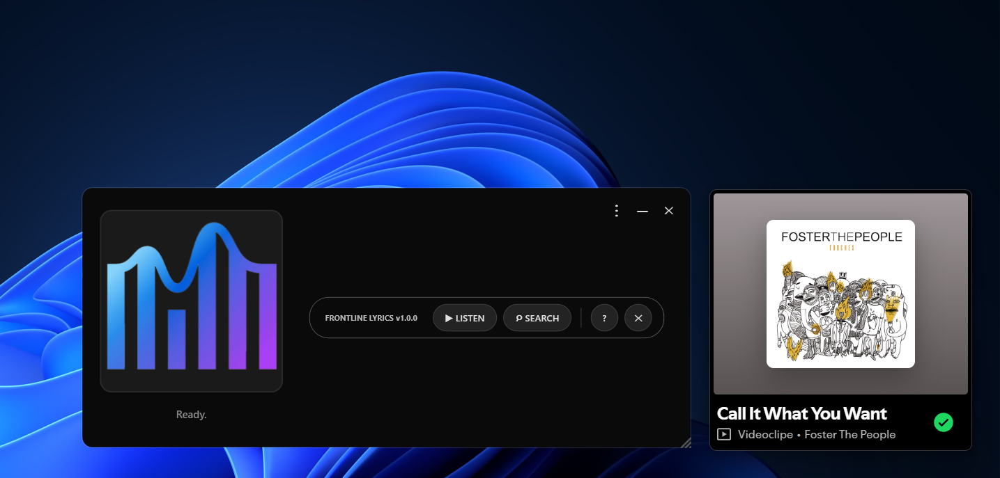
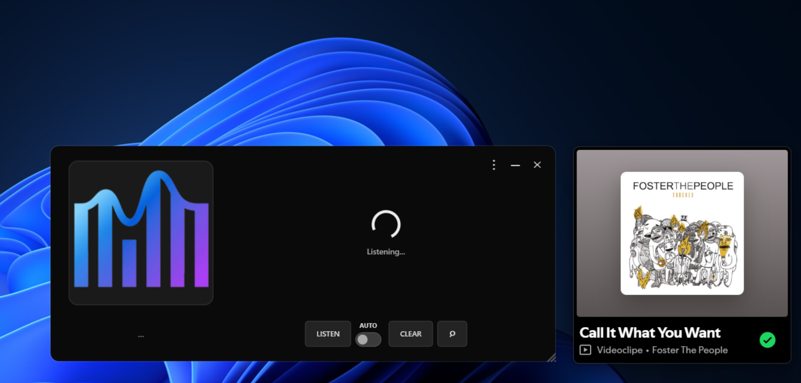
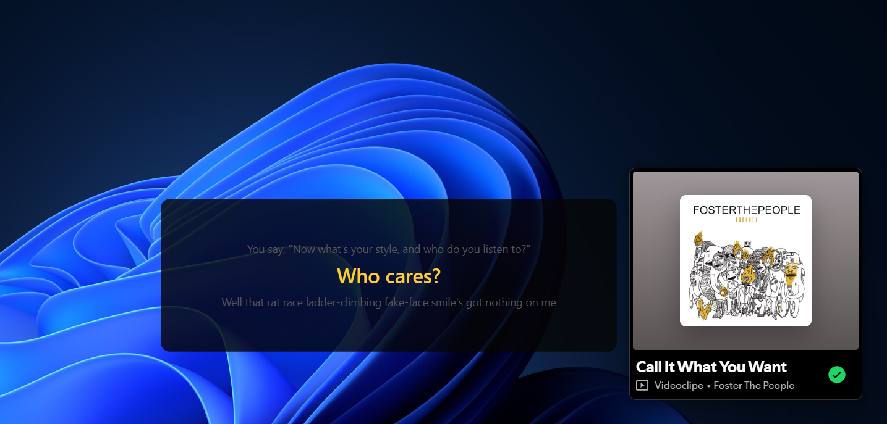

<div align="center">


**Real-time, synchronized lyrics for the music playing on your computer.**

[](https://apps.microsoft.com/detail/9P6LNJCL8ZCC)


</div>

---

## Contents

- [About](#about)
- [Features](#features)
- [How It Works](#how-it-works)
- [Installation](#installation)
- [Usage](#usage)
- [Screenshots](#screenshots)
- [Project Structure](#project-structure)
- [Building From Source](#building-from-source)
- [Running Tests](#running-tests)
- [Contributing](#contributing)
- [Support](#support)
- [License](#license)

## About

FrontLine Lyrics displays synchronized song lyrics in an always-on-top desktop overlay. It can follow playback metadata from compatible media players or recognize music from system audio, then look up synchronized lyrics and show them as the song plays.

The project supports a Windows desktop frontend and a Linux frontend sharing a Python-based backend. Availability and integration details depend on the platform.

## Features

- Real-time synchronized lyrics in a customizable desktop overlay.
- Song recognition using audio fingerprinting.
- Automatic tracking from supported media sessions (Windows media sessions / Linux MPRIS).
- Manual lyrics search and synchronization adjustments.
- Live translation and romanization options.
- Font, color, and theme customization, including seasonal themes.
- Multiple interface languages.
- Festival Mode with editable setlists and manual line synchronization (feature availability may vary by platform).
- Optional anonymous telemetry; see [PRIVACY.md](PRIVACY.md).

## How It Works

FrontLine Lyrics has two parts: a **Python backend** that handles recognition, lyrics, translation, and media integration, and a **desktop frontend** that displays the lyrics and communicates with the backend over a local WebSocket connection.

- **Windows:** WPF / .NET frontend, with Windows media-session and WASAPI audio integration.
- **Linux:** Avalonia / .NET frontend, with Linux-specific media and audio integration.

## Installation

### Windows

Install the official Windows version from the [Microsoft Store](https://apps.microsoft.com/detail/9P6LNJCL8ZCC).

### Linux

The Linux version is being prepared for distribution. Until it is published, you can [build a `.deb` or `.snap` locally](#building-from-source).

## Usage

1. Launch FrontLine Lyrics and start playing music.
2. Use **LISTEN** to recognize a track, or enable **AUTO** to follow playback when supported.
3. Use **SEARCH** to find lyrics manually.
4. Adjust the overlay appearance, lyric size, and synchronization as needed.
5. Use translation controls and other features available on your platform.

## Screenshots

<p align="center">
  
  
  
</p>

## Project Structure

```text
Frontline/                Windows desktop app (WPF)
FrontLine-Linux/          Linux desktop app (Avalonia) and packaging scripts
FrontlineServer/          Shared Python backend
FrontlinePackaging/       Windows packaging resources
.github/                  CI workflows
docs/                    Project website
```

Both desktop applications share the recognition and lyrics engine, with platform-specific integrations where necessary.

## Building From Source

These instructions are for **local Linux builds**, not for publishing to a store. The build scripts create a `.deb` or `.snap` that you can install on your own computer.

### Requirements

- An **Ubuntu/Debian-based Linux system**; the current Snap configuration targets **Ubuntu 26.04 (`core26`)**.
- An **amd64 (x86-64)** machine for the current Snap build.
- Git, Python and its required build dependencies, and the **.NET 10 SDK**.
- For `.deb` builds: `dpkg-deb` and any tools required by `packaging-deb/build-deb.sh`.
- For `.snap` builds: Snapcraft and a working Snapcraft build environment (plus the `.deb` prerequisites, since the Snap script builds the `.deb` first).

The packaging scripts are the source of truth for additional build tools and dependencies. If a prerequisite is missing, install it before running the build.

### Clone the repository

```bash
git clone https://github.com/juliocax/FrontLine-Lyrics-Desktop.git
cd FrontLine-Lyrics-Desktop/FrontLine-Linux
```

### Option A — Build and install a `.deb`

```bash
chmod +x packaging-deb/build-deb.sh
FRONTLINE_PACKAGE_VERSION=1.0.0-1 ./packaging-deb/build-deb.sh
sudo apt install ./dist-linux/frontline-lyrics_1.0.0-1_amd64.deb
```

### Option B — Build and install a `.snap`

The Snap build script also runs the `.deb` build and regenerates its payload, including the launcher and bundled backend.

```bash
cd packaging-snap
chmod +x build-snap.sh prepare-snap.sh frontline-lyrics-snap.sh
./build-snap.sh 1.0.0
sudo snap install ./frontline-lyrics_1.0.0_amd64.snap --dangerous
snap run frontline-lyrics
```

The `--dangerous` flag is required for a **locally built, unsigned** Snap. It does **not** disable the snap's `strict` confinement. The current Snap includes its own runtime dependencies, including the Fontconfig setup used by the launcher.

> **Note:** The Linux packaging scripts and their source files must be committed to this repository for these instructions to work on a fresh clone. Builds and integration with media players/audio devices can vary by desktop environment and permissions.

## Running Tests

The Python backend includes a test suite. From the repository root, after setting up the Python environment and development requirements:

```bash
cd FrontlineServer
python -m pip install -r requirements.txt
python -m pip install -r requirements-dev.txt
python -m pytest
```

## Contributing

Contributions and bug reports are welcome. Please see [CONTRIBUTING.md](CONTRIBUTING.md) and [CODE_OF_CONDUCT.md](CODE_OF_CONDUCT.md).

## Support

If FrontLine Lyrics is useful to you, consider [supporting the project](https://www.buymeacoffee.com/juliocax).

## License

See [LICENSE.txt](LICENSE.txt) for the repository's license terms.
